# Cacao con historia · Trazabilidad de cacao para Asoprocacao

MVP del **II Hackathon de Programación** (USCO, Semillero DEVURITY, 15 y 16 de octubre de 2026) para la asociación cacaotera **Asoprocacao** de Campoalegre (Huila). Conecta la **recepción**, la **transformación** y la **comercialización** del cacao con trazabilidad lote a lote, inventario que no deja consumir de más, alertas con regla y causa, balance económico, **ficha pública con QR** para el comprador, auditoría inalterable y respaldo con verificación de integridad.


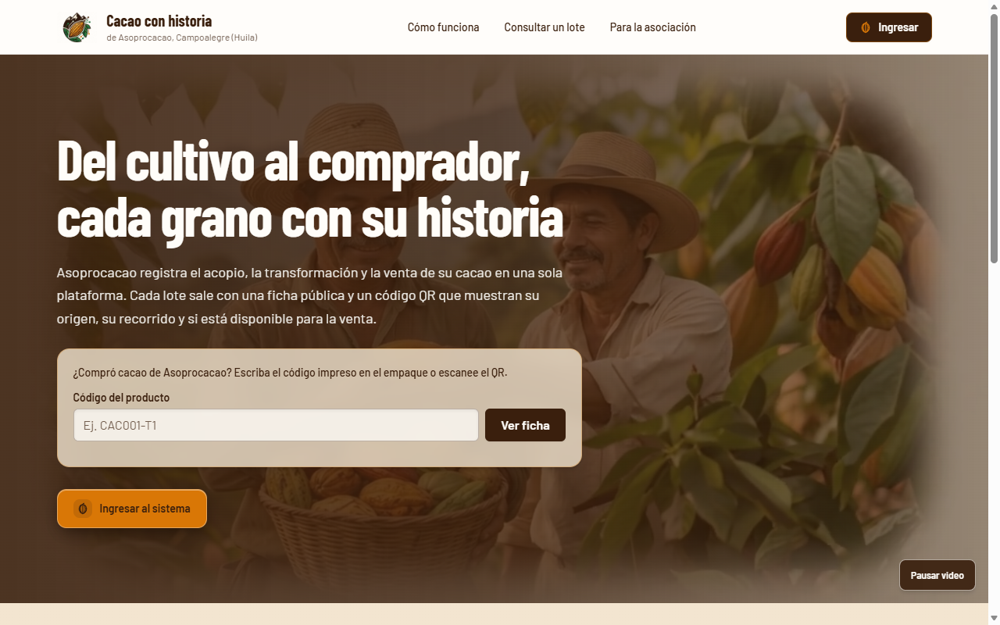

> **Para los agentes.** Este archivo es el contexto del proyecto y se **versiona** como registro de uso de herramientas, como exige el reto. Claude Code lo lee como `CLAUDE.md`; agy (Antigravity CLI) lo lee a través de `GEMINI.md`, que solo contiene `@./CLAUDE.md`. La fuente de verdad técnica es [`docs/CONTRATO_TECNICO.md`](docs/CONTRATO_TECNICO.md), que se importa abajo: si este archivo y el contrato se contradicen, manda el contrato. Las reglas para trabajar en el repositorio están en la [sección 16](#16-cómo-trabajar-en-este-repositorio). Este archivo se cambia solo por PR a `main`.

@./docs/CONTRATO_TECNICO.md

**Entrega final:** etiqueta `v1.0-entrega` → commit `25e8606b5f6bea06edb281a4572100f43a52bc37` (16/10/2026, 12:20) · Índice: [`ENTREGA.md`](ENTREGA.md) · Documentación: [`documentos/E01-E09_documentacion_KGB.pdf`](documentos/E01-E09_documentacion_KGB.pdf) · Pitch: [`pitch/`](pitch/) · Tablero: <https://github.com/users/JuanFierro15/projects/1>

---

## Contenido

- [1. Sobre el proyecto](#1-sobre-el-proyecto)
- [2. Equipo KGB](#2-equipo-kgb)
- [3. Funcionalidades](#3-funcionalidades)
- [4. Reglas del negocio](#4-reglas-del-negocio)
- [5. Arquitectura](#5-arquitectura)
- [6. Modelo de datos](#6-modelo-de-datos)
- [7. API](#7-api)
- [8. Stack tecnológico](#8-stack-tecnológico)
- [9. Estructura del repositorio](#9-estructura-del-repositorio)
- [10. Instalación y uso local](#10-instalación-y-uso-local)
- [11. Pruebas y evidencia](#11-pruebas-y-evidencia)
- [12. Respaldo y restauración](#12-respaldo-y-restauración)
- [13. Diseño, accesibilidad y rendimiento](#13-diseño-accesibilidad-y-rendimiento)
- [14. Avance por bloques](#14-avance-por-bloques)
- [15. Ciclo de vida y entrega](#15-ciclo-de-vida-y-entrega)
- [16. Cómo trabajar en este repositorio](#16-cómo-trabajar-en-este-repositorio)
- [17. Aprendizajes](#17-aprendizajes)
- [18. Herramientas, fuentes y créditos](#18-herramientas-fuentes-y-créditos)
- [19. Pendientes tras la entrega](#19-pendientes-tras-la-entrega)

---

## 1. Sobre el proyecto

Reto "Cacao con historia, calidad y valor" de la II Feria Universitaria de CTeI del Huila: 24 horas de construcción. El cliente, las organizaciones y los datos son **sintéticos**; Asoprocacao es un cliente simulado y el equipo no hizo consultas reales a la asociación.

| Exigencia del reto | Cómo se cumple |
|---|---|
| RF01–RF12 funcionando con valores que cambia el jurado | Todo número sale de la API; ninguna pantalla tiene cifras fijas |
| Reglas de inventario, costos, estados y permisos | En el **backend** (`servicio/`) y en la base (restricciones `CHECK`, `UNIQUE` y un trigger); el frontend nunca es la única barrera |
| Persistencia real | PostgreSQL 16 con Flyway (`V1`, `V2`) y `ddl-auto=validate`; los datos sobreviven al reinicio |
| No exponer costos al público | La ficha pública se arma con un DTO de lista blanca, nunca con la entidad |
| No consumir más de lo disponible | Bloqueo pesimista del lote, 422 si se pide de más e idempotencia por `operacionUuid` |
| Liberar solo con autorización | `PATCH /api/lotes/{codigo}/estado` solo para ADMINISTRADOR, con motivo; 403 al operador |
| Respaldo y restauración verificables | Scripts en PowerShell y bash que comparan conteos, kg y códigos antes y después |
| Mínimo 5 pruebas automatizadas y 15 casos | 52 pruebas JUnit contra PostgreSQL real, más casos por API y por la interfaz |
| Consulta sobre 100 registros en menos de 3 s | p95 de 22,27 ms sobre 400 lotes |
| Etiqueta final con hash | `v1.0-entrega` → `25e8606b5f6bea06edb281a4572100f43a52bc37` |

**Cómo se califica** (pesó en cada decisión): funcionamiento real RF01–RF12, 25 puntos; diseño y calidad técnica, 15; pruebas y confiabilidad, 15; experiencia de usuario, pertinencia, requisitos y ciclo de vida, 10 cada uno; innovación y viabilidad, 10; pitch, 5. Fallas críticas: perder registros, consumir más de lo disponible, exponer costos al público y liberar sin autorización.

**Diferenciadores:**
1. **Alerta de cuota por finca:** cada productor tiene una cuota anual plausible según sus hectáreas; una entrega que la supera genera la alerta `CUOTA_EXCEDIDA` en el acopio (avisa, no bloquea).
2. **Merma en vivo y causa en un toque:** semáforo de merma mientras se pesa y chips de incidencia que llenan la justificación con un clic.
3. **Simulador de margen** para el administrador (el backend calcula; el navegador no).
4. **Retiro inmediato:** bloquear un lote retiene en cascada todo lo que salió de él, con reporte de recall y kilos afectados.

---

## 2. Equipo KGB

| Integrante | Rol | Rama |
|---|---|---|
| **Miguel Ángel Medina Díaz** | Base de datos y backend: entidades, seguridad JWT, reglas, pruebas JUnit y scripts de respaldo | `feat/backend-api` |
| **Juan David Fierro Calderón** | Frontend, identidad visual e integración: rendimiento, respaldo de demostración, README, `ENTREGA.md`, tablero, PR y etiqueta | `feat/frontend-ui`, `feat/integracion` |
| **Juan Manuel Villalba Rincón** | Documentación contra lo construido, casos manuales, prueba de usabilidad, instalación limpia y **presentación del pitch** | Sin rama |

El contexto inicial del reto ponía a Juan Manuel en la base de datos; el equipo se reorganizó al inicio y la base quedó con Miguel (registro en `prompts/integracion/reorganizacion.md`). La rama `design-test` (16/10, 09:37–11:32) la trabajaron Miguel y Juan David.

---

## 3. Funcionalidades

Tres tipos de usuario: el **operador** de acopio y planta, el **administrador** de la asociación y el **comprador**, que no inicia sesión.

### Inicio público y acceso

`/` muestra, sin sesión, la página de inicio: héroe con video, consulta de un lote por su código (abre un modal con la ficha), "El recorrido del grano" con la traza animada y lo que cambia para la asociación. Con sesión, `/` lleva al panel del rol. El login (`/login`) tiene video de fondo con botón de pausa, logo, retorno al inicio y botones para autocompletar los usuarios de demostración.

| Inicio | Inicio de sesión |
|:---:|:---:|
|  | 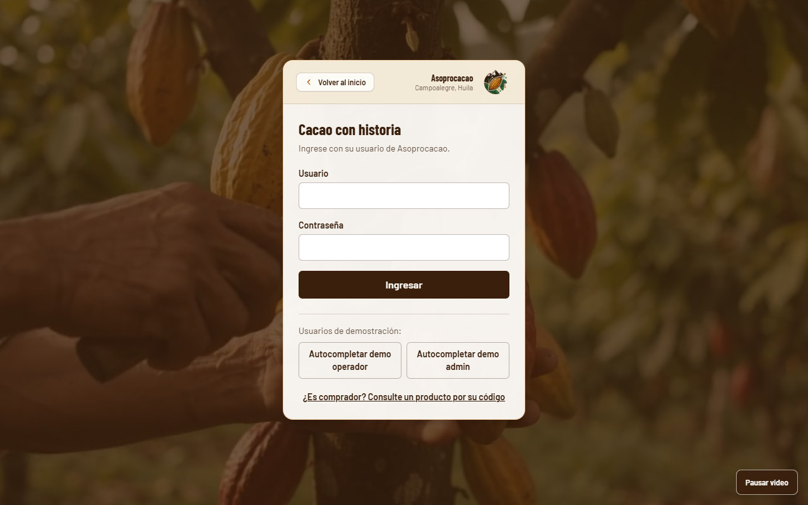 |

### Recepción de lotes (RF01) con alerta de cuota

El operador elige el productor (ve finca, municipio, variedad, hectáreas, cuota anual y lo entregado en el año), la fecha, el tipo de grano (seco o en baba), la humedad y la cantidad. El backend asigna el código `CACnnn` (o acepta uno manual único), rechaza cantidades inválidas con un error junto a cada campo y genera la alerta de cuota. La vista previa avisa antes de registrar.

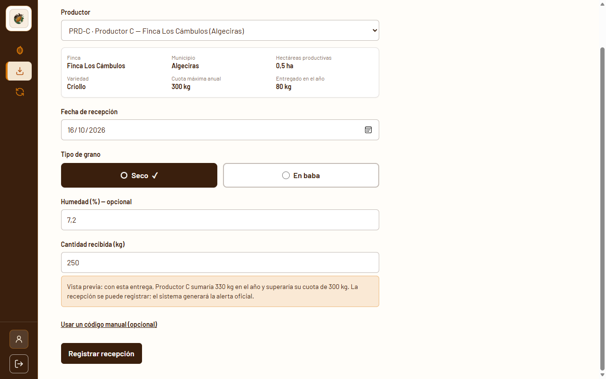

### Transformación (RF02, RF08) con semáforo de merma y chips

Se elige el lote de origen (solo los que tienen disponible y no están bloqueados), la etapa (las 6 del catálogo), el responsable, la entrada y la salida. El **semáforo** muestra la merma en vivo (verde < 10 %, ámbar hasta el umbral, rojo por encima) como *vista previa*; el valor oficial lo calcula el backend. Los **chips de incidencia** llenan la justificación con un clic ("Adición de insumos" abre el campo de insumos). Cada operación lleva un `operacionUuid`: el botón "Reenviar la misma operación" demuestra que un reenvío responde 409 y no consume dos veces.

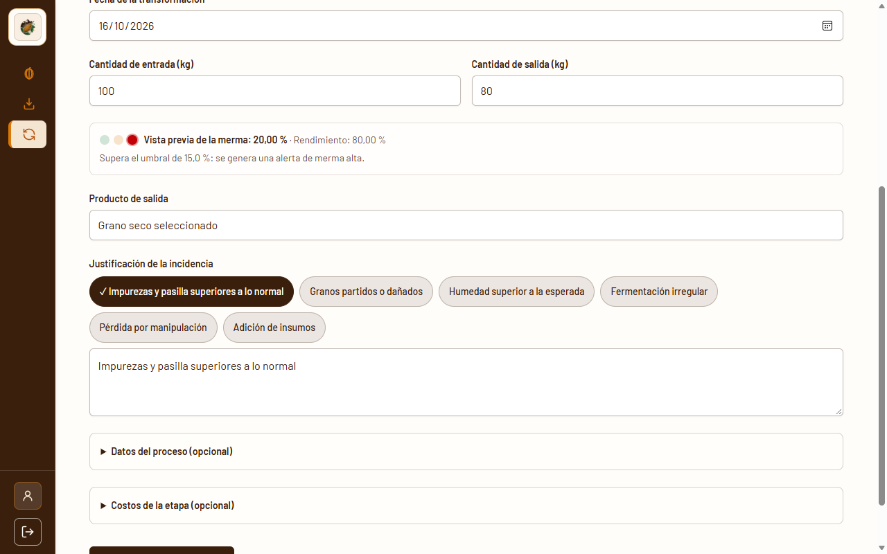

### Trazabilidad, estado y QR (RF03, RF09)

`/lotes/:codigo/trazabilidad` muestra el origen (productor, finca, municipio, variedad, hectáreas), el lote de recepción, el inventario del lote, la **línea de tiempo** desde la recepción hasta el último derivado (dibujada con "la traza"), los derivados, las alertas del recorrido, el tiempo de la consulta y el **código QR** con el enlace a la ficha pública. Los botones **Bloquear** y **Liberar** piden un motivo y se ven también para el operador: el servidor le responde 403 ("Solo el Administrador puede liberar o bloquear lotes"), y así se demuestra que el control está en el backend.

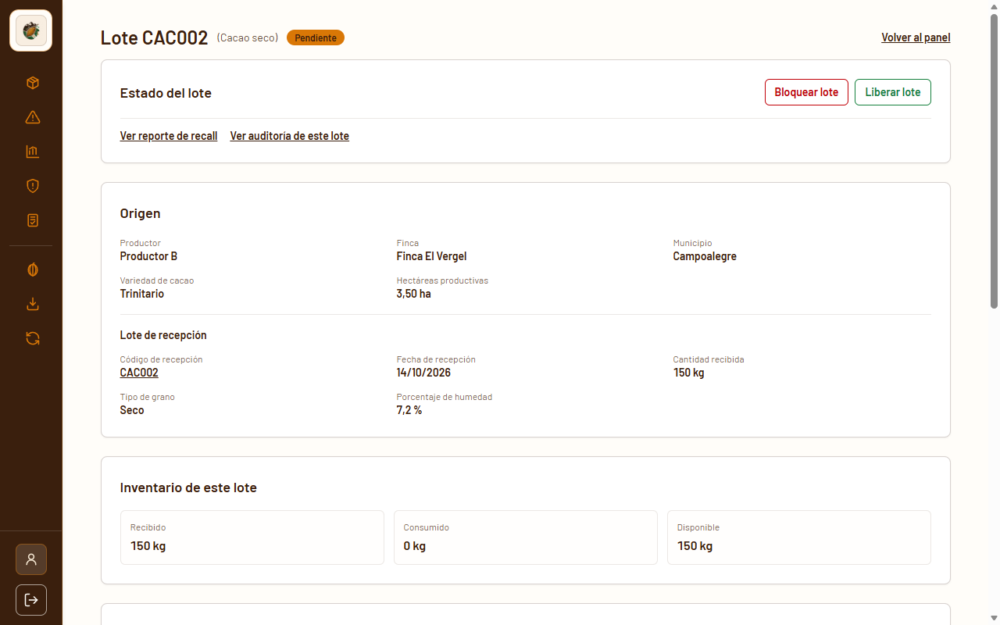

### Ficha pública: el pasaporte digital del producto (RF06)

`/ficha/:codigo` no pide sesión: es lo que abre el QR. La consulta por código del inicio y de `/ficha`, el enlace "¿Es comprador?" del login y "Abrir ficha pública" de la trazabilidad muestran la misma ficha en un modal (`ModalFichaComprador`). Muestra primero el **estado** como un sello (verde "Disponible para la venta", ámbar "Aún no está disponible", rojo "Producto retenido: no está disponible para la venta" con `role="alert"`), el producto y el lote, el origen por finca, municipio, departamento y variedad, y el recorrido. Nunca muestra costos, precios, márgenes, cantidades, merma, responsables, el nombre de la persona productora (Ley 1581 de 2012), hectáreas, cuota, motivo del estado, alertas ni ids internos.

<p align="center">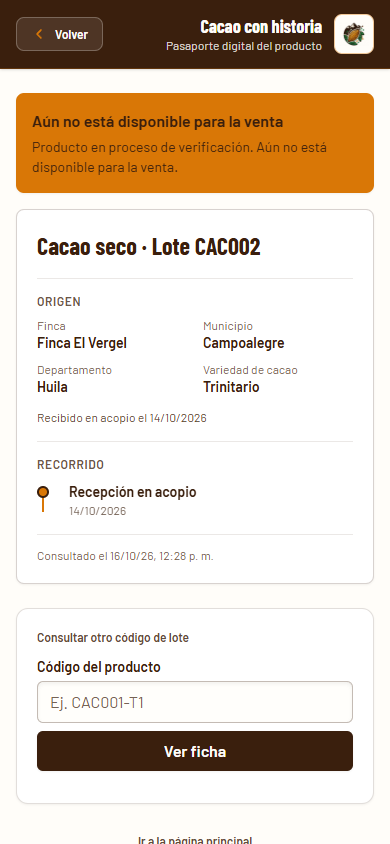</p>

### Panel del administrador (RF04, RF05, RF09–RF12)

- **Inventario** (`/admin`): recibido, consumido y disponible por lote, con filtros por origen, estado y tipo, y descarga del **CSV** para Excel (UTF-8 con BOM, `;` y coma decimal).
- **Alertas** (`/admin/alertas`): tipo, regla aplicada y causa con los valores reales; filtro por lote y por activas.
- **Balance económico** (`/admin/balance`): costo unitario y margen de cada transformación con las **fórmulas tal como las arma el backend** y un **simulador de precio** que no guarda nada.
- **Recall** (`/admin/recall/:codigo`): origen, cantidades, derivados con su estado, kilos afectados en inventario e historial conservado.
- **Auditoría** (`/admin/auditoria`): quién, con qué rol, cuándo, qué campo, valor anterior y nuevo, y motivo; solo lectura.

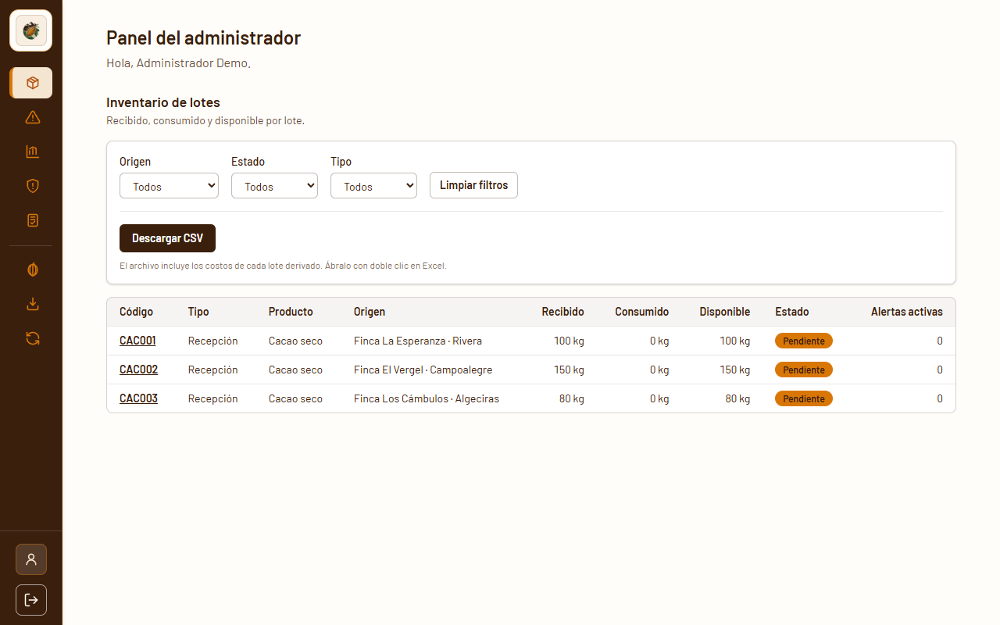

### Gestión de operadores y perfil del administrador (adicional a RF01–RF12)

`/admin/usuarios` ("Perfil y gestión de operadores"), solo para el administrador: crear operadores, cambiar su nombre o contraseña, suspenderlos o eliminarlos, y cambiar el perfil propio (pide la contraseña actual). Cada cambio queda en la auditoría sin guardar contraseñas.

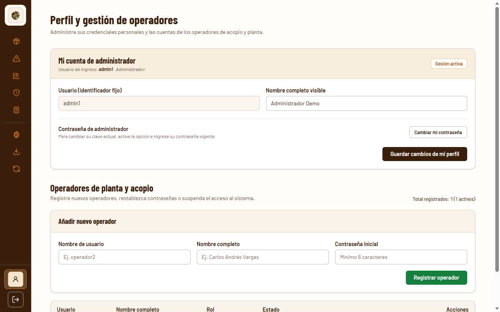

### Versión móvil

Operador, comprador y administrador funcionan a 360 px sin scroll horizontal. Por debajo de 640 px la navegación interna es un **menú hamburguesa**: una barra de 57 px con el botón de menú, y un panel a una columna con los textos completos que se cierra con Escape, al elegir un enlace o al tocar fuera.

<p align="center">
  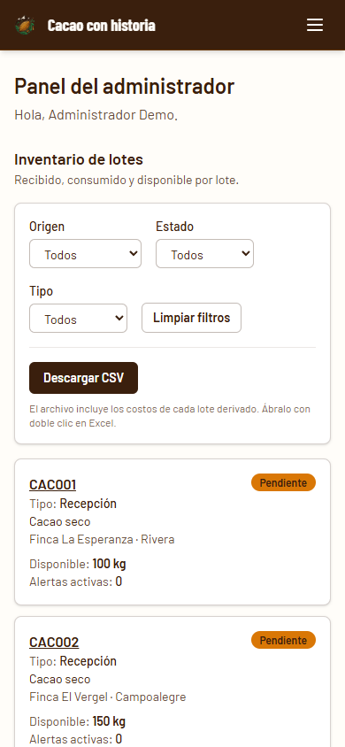
  &nbsp;&nbsp;
  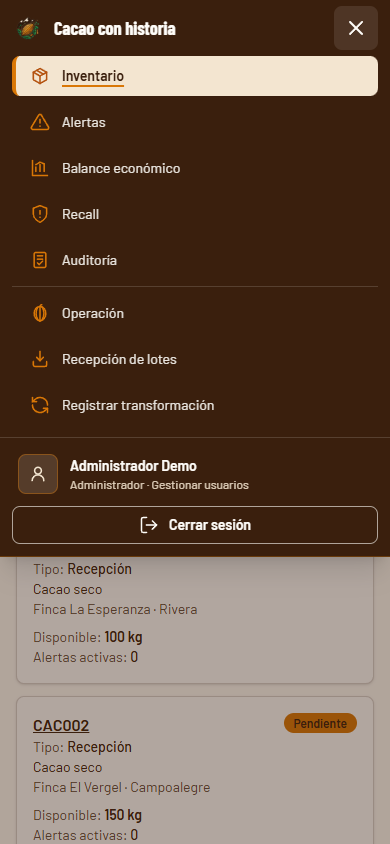
</p>

---

## 4. Reglas del negocio

Se calculan en el backend con `BigDecimal` y `RoundingMode.HALF_UP` (porcentajes y COP con 2 decimales, kg con 3). La clase pura `CalculadoraTransformacion` concentra los cálculos.

| Regla | Valor o condición |
|---|---|
| Merma | `(entrada − salida) ÷ entrada × 100` |
| Rendimiento | `salida ÷ entrada × 100` |
| Alerta MERMA_ALTA | merma mayor que `APP_UMBRAL_MERMA` (15,0 %) |
| Alerta REGISTRO_INCOMPLETO | merma mayor que el umbral **y** justificación vacía |
| Costo unitario | `costo de la etapa ÷ kg de salida` |
| Margen | `(precio − costo unitario) ÷ precio × 100` |
| Alerta SOBRECOSTO | margen negativo |
| División entre cero | salida 0 → costo y margen `null`, `calculable: false` con el motivo; precio 0 → margen `null` |
| Inventario | entrada mayor que lo disponible → 422, sin cambios |
| Idempotencia | mismo `operacionUuid` → 409 `OPERACION_DUPLICADA`, sin segundo consumo |
| Salida mayor que entrada | solo con `insumosAgregados`; se muestra como "balance con insumos" |
| Lote bloqueado | no se transforma → 409 |
| Cuota de plausibilidad | entregado en el año + kg nuevos mayor que `cuota_maxima_kg` → alerta `CUOTA_EXCEDIDA` (no bloquea) |
| Bloqueo | solo ADMINISTRADOR, motivo de 10 a 300 caracteres, **se propaga a todos los derivados** |
| Liberación | solo ADMINISTRADOR, con motivo, no se propaga; si un ancestro está bloqueado → 409 `ORIGEN_BLOQUEADO` |
| Mismo estado | pedir el estado actual → 409 `ESTADO_SIN_CAMBIO`, sin auditoría |
| Lote derivado | código `<raíz>-Tn`, hereda productor y municipio, nace PENDIENTE; una fila en `lote_composicion` |
| Cuentas de usuario | nombre único (409), contraseña de al menos 6 caracteres (400), el administrador no se suspende ni se elimina a sí mismo (422) |

**Caso del jurado:** CAC001 con 100 kg → 80 kg da merma de **20,00 %**, alerta MERMA_ALTA y CAC001-T1 con 80 kg; con costo de 1.600.000 COP y precio de 25.000 COP/kg, costo unitario de **20.000 COP/kg** y margen de **20,00 %**. Pedir 120 kg sobre 100 → 422 y el lote conserva 100 kg.

**Datos semilla (`V2`):** productores PRD-A (Rivera), PRD-B (Campoalegre) y PRD-C (Algeciras, 0,5 ha, cuota de 300 kg); lotes CAC001 (100 kg), CAC002 (150 kg) y CAC003 (80 kg), secos y PENDIENTES. **CAC001 queda sin transformaciones para el jurado**: los ensayos usan otros lotes y se restaura `respaldo_demo.dump` después.

---

## 5. Arquitectura

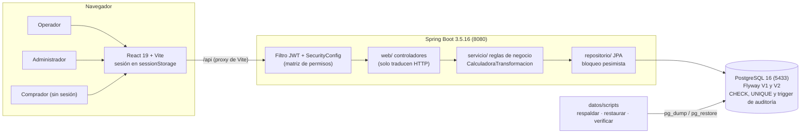

- **Las reglas viven en `servicio/`.** Los controladores solo traducen HTTP; la base refuerza con restricciones (`cantidad_disponible >= 0`, `operacion_uuid UNIQUE`, estados válidos) y un trigger que rechaza `UPDATE`, `DELETE` y `TRUNCATE` sobre `auditoria_cambios`.
- **Seguridad sin estado:** JWT HS256 (`sub` = usuario, `rol`), `SessionCreationPolicy.STATELESS`, permisos en un solo lugar (`SecurityConfig`), 401 y 403 con el mismo formato JSON de error.
- **Ficha pública con lista blanca:** `FichaPublicaController` arma un DTO propio; ninguna entidad JPA sale hacia afuera.
- **Frontend:** React Router 7 en modo declarativo (`BrowserRouter`); `api/cliente.js` agrega el token y traduce los errores; `api/simulaciones.js` (con `VITE_USE_MOCKS=true`) reproduce el contrato y nunca entra al build normal.

**Una transformación, todo o nada** (`@Transactional`, en el orden del contrato):

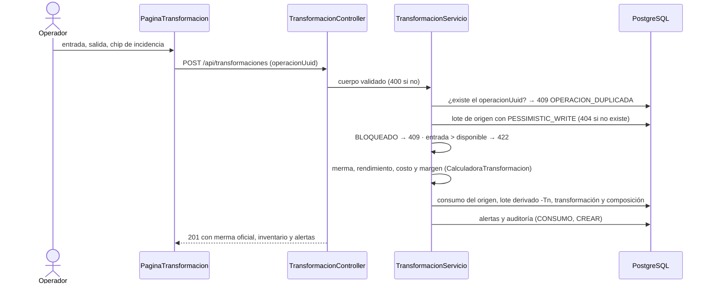

Si dos envíos simultáneos chocan en el `UNIQUE` de `operacion_uuid`, se captura la violación y se responde 409.

---

## 6. Modelo de datos

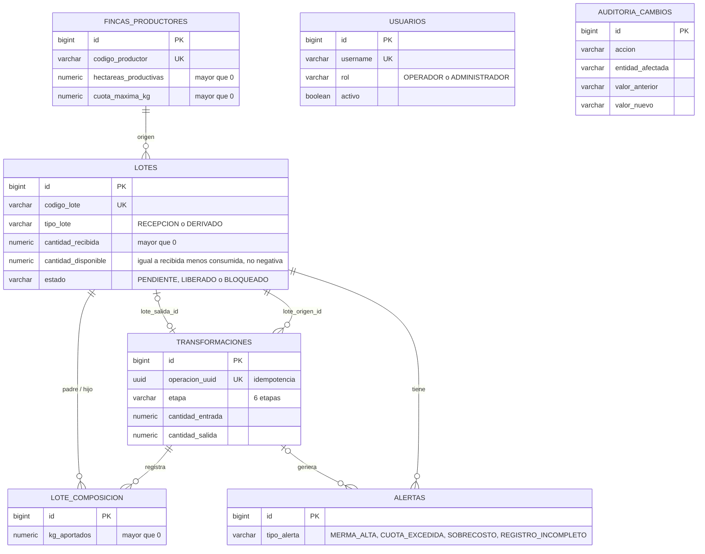

- `auditoria_cambios` no tiene llaves foráneas (guarda usuario y rol como texto) y es **solo inserción** por trigger.
- La genealogía se recorre con consultas recursivas sobre `lote_composicion`, hacia atrás (ancestros) y hacia adelante (derivados).
- El esquema solo cambia con una migración nueva; `V1` y `V2` nunca se editan.

---

## 7. API

Base `/api`, JSON en camelCase, números como números. Documentación interactiva en `http://localhost:8080/swagger-ui/index.html`. El detalle de cada respuesta está en el contrato (sección 8).

| Método y ruta | Público | Operador | Administrador |
|---|:-:|:-:|:-:|
| `POST /api/auth/login` | ✔ | ✔ | ✔ |
| `GET /api/public/ficha/{codigo}` | ✔ | ✔ | ✔ |
| `GET /api/config/reglas`, `GET /api/productores` | | ✔ | ✔ |
| `POST /api/lotes`, `GET /api/lotes`, `GET /api/lotes/{codigo}` | | ✔ | ✔ |
| `GET /api/lotes/{codigo}/trazabilidad` | | ✔ | ✔ |
| `POST /api/transformaciones`, `GET /api/transformaciones` | | ✔ | ✔ |
| `PATCH /api/lotes/{codigo}/estado` | | 403 | ✔ |
| `GET /api/lotes/{codigo}/recall` | | 403 | ✔ |
| `GET /api/transformaciones/{id}/balance[?precioVentaCop=]` | | 403 | ✔ |
| `GET /api/alertas`, `GET /api/auditoria` | | 403 | ✔ |
| `GET /api/reportes/exportar-csv` | | 403 | ✔ |
| `GET/POST /api/usuarios`, `PUT/PATCH/DELETE /api/usuarios/{id}`, `POST /api/usuarios/{id}/eliminar` | | 403 | ✔ |

**Formato único de error:** `{ timestamp, status, codigo, mensaje, errores[] }`, con `errores` por campo en las validaciones. Códigos: `VALIDACION` (400), `CREDENCIALES_INVALIDAS` y `NO_AUTENTICADO` (401), `ACCESO_DENEGADO` (403), `NO_ENCONTRADO` (404), `LOTE_DUPLICADO`, `USUARIO_DUPLICADO`, `OPERACION_DUPLICADA`, `LOTE_BLOQUEADO`, `ORIGEN_BLOQUEADO` y `ESTADO_SIN_CAMBIO` (409), `INVENTARIO_INSUFICIENTE`, `SALIDA_SIN_JUSTIFICACION` y `OPERACION_NO_PERMITIDA` (422), `ERROR_INTERNO` (500, sin trazas).

La gestión de usuarios (`/api/usuarios`) no está en la tabla de permisos del contrato; su permiso está en `SecurityConfig`.

---

## 8. Stack tecnológico

| Área | Tecnología |
|---|---|
| Base de datos | PostgreSQL 16 (Docker `postgres:16-alpine` en el puerto 5433, o instalado en el PC) |
| Migraciones | Flyway con `flyway-database-postgresql` |
| Backend | Java 21 · Spring Boot 3.5.16 (Web, Security, Data JPA, Validation) · jjwt 0.12.6 · springdoc-openapi 2.8.6 · sin Lombok (getters explícitos y DTO como `record`) |
| Pruebas | JUnit 5, Spring Boot Test y Spring Security Test contra la base real `cacao_test` (sin H2 ni Testcontainers) |
| Frontend | React 19.2 · React Router 7.18 · Vite 8.3 · Tailwind CSS 4.3 (`@tailwindcss/vite`, tokens en `@theme`) · `qrcode.react` 4.2 · JavaScript (JSX), sin TypeScript |
| Tipografía | Barlow y Barlow Condensed con `@fontsource` 5.3 (sin CDN: la demo puede quedarse sin internet) |
| Calidad de código | oxlint 1.81 |
| Respaldo | `pg_dump` / `pg_restore` con scripts en PowerShell y bash que detectan el modo Docker o local |

**¿Por qué Spring Boot 3.5.16 y no 4.x?** Spring Initializr ya genera 4.x, pero el equipo domina la rama 3 y así evitó migrar a Jackson 3 y Spring Security 7 durante el hackathon. Limitación declarada: fin de soporte comunitario en junio de 2026.

---

## 9. Estructura del repositorio

```
backend/                       Spring Boot (equivale a src/)
├── src/main/java/co/edu/usco/cacao/
│   ├── config/                SecurityConfig, DataInitializer (usuarios demo), OpenApiConfig
│   ├── seguridad/             JwtServicio, filtro JWT, 401 y 403 en JSON, ContextoAutenticacion
│   ├── dominio/               Lote, Transformacion, FincaProductor, LoteComposicion, Alerta,
│   │                          AuditoriaCambio, Usuario y sus enums
│   ├── repositorio/           JPA, consultas recursivas y bloqueo pesimista
│   ├── servicio/              Reglas: Lote, Transformacion, CalculadoraTransformacion, Trazabilidad,
│   │                          Alerta, Auditoria, Reporte (CSV), Catalogo, Usuario
│   ├── web/ y web/dto/        Controladores y DTO (la ficha pública tiene el suyo)
│   └── excepcion/             CodigoError, ReglaNegocioException y el manejador global
├── src/main/resources/db/migration/   V1__esquema_inicial.sql y V2__datos_semilla.sql
└── src/test/java/co/edu/usco/cacao/   52 pruebas (equivale a tests/)
frontend/                      React + Vite + Tailwind
├── DISENO.md                  Guía de identidad visual (tokens, tipografía, la traza, sello, video)
├── public/assets/             Logo, fotos y videos optimizados
└── src/
    ├── api/                   cliente.js (token y errores), servicios.js, simulaciones.js
    ├── auth/                  AuthContext, RutaProtegida, roles y sesión (sessionStorage)
    ├── componentes/           MarcoAplicacion (barra lateral y menú hamburguesa), SemaforoMerma,
    │                          ChipsIncidencia, ControlEstadoLote, CodigoQrFicha, FondoVideo,
    │                          ModalFichaComprador, TablaLotes, ListaAlertas, InsigniaEstado…
    ├── paginas/               inicio, login, operador, lotes (trazabilidad), admin, publico
    └── utilidades/            formato (es-CO), merma, uuid, urlFicha, useConsultaApi, useAlAparecer
datos/
├── scripts/                   respaldar, restaurar (.ps1 y .sh) y verificar_integridad.sql
├── respaldos/                 respaldo_demo.dump, su reporte de integridad y LEEME.md
└── rendimiento/               carga de 100 cadenas PERF, limpieza, medición y resultados
docs/
├── CONTRATO_TECNICO.md        Fuente de verdad: API, datos, reglas, permisos y propiedad
└── capturas/                  Capturas de este archivo
documentos/                    E01-E09_documentacion_KGB.pdf (documento único de la entrega)
pitch/                         E09_presentacion.pdf (5 diapositivas) y E09_guion.md
prompts/                       Registro de uso: un archivo por bloque y una bitácora por área
├── backend/  frontend/  integracion/
└── BITACORA.md                Índice (nunca se le agregan filas)
.claude/skills/ y .agents/skills/   Skills de diseño versionadas como registro
README.md · ENTREGA.md · CLAUDE.md · GEMINI.md · docker-compose.yml · .env.example
```

---

## 10. Instalación y uso local

La guía completa, probada desde un clon nuevo, está en [`README.md`](README.md). Resumen en modo Docker:

```bash
git clone https://github.com/JuanFierro15/cacao-trazabilidad-huila.git
cd cacao-trazabilidad-huila
cp .env.example .env           # cambiar POSTGRES_PASSWORD y JWT_SECRET (mínimo 32 caracteres)
docker compose up -d           # PostgreSQL 16 en el puerto 5433
cd backend && ./mvnw spring-boot:run      # Windows: .\mvnw.cmd spring-boot:run · Flyway crea el esquema
cd frontend && npm ci && npm run dev      # http://localhost:5173
```

Sin Docker (modo local), PostgreSQL 16 instalado en el PC con el rol y la base `cacao`, y su puerto en `DB_PORT` (README, sección 2).

| Variable (`.env`, nunca se sube) | Uso |
|---|---|
| `POSTGRES_DB`, `POSTGRES_USER`, `POSTGRES_PASSWORD`, `DB_HOST`, `DB_PORT` | Base de datos (la leen Docker Compose, el backend y los scripts) |
| `JWT_SECRET` | Firma del token; mínimo 32 caracteres (HS256) |
| `JWT_EXPIRACION_MINUTOS` | Vida del token (480) |
| `APP_UMBRAL_MERMA` | Umbral de la alerta de merma (15.0) |
| `APP_CORS_ORIGENES` | Orígenes permitidos fuera del proxy de Vite |
| `VITE_PUBLIC_BASE_URL` | Base del enlace del QR; para el celular, `http://<IP-del-PC>:5173` |
| `VITE_USE_MOCKS` | `true` usa las simulaciones del frontend sin backend |

| Dirección | Qué es |
|---|---|
| `http://localhost:5173` | Página de inicio pública; "Ingresar" lleva al inicio de sesión |
| `http://localhost:5173/ficha` y `/ficha/<código>` | Ficha pública, sin inicio de sesión |
| `http://localhost:8080/swagger-ui/index.html` | Documentación interactiva de la API |

| Usuario de demostración | Contraseña | Rol |
|---|---|---|
| `operador1` | `cacao123` | OPERADOR |
| `admin1` | `admin123` | ADMINISTRADOR |

Son credenciales de demostración publicadas a propósito; el `DataInitializer` las crea solo si no existen.

---

## 11. Pruebas y evidencia

```bash
cd backend && ./mvnw test        # 52 pruebas contra la base cacao_test (Windows: .\mvnw.cmd test)
cd frontend && npm run build     # build de producción
cd frontend && npm run lint      # oxlint
```

La base `cacao_test` se crea una vez (`docker compose exec db createdb -U cacao cacao_test`); Flyway la limpia y la migra al iniciar la suite, con un seguro que solo permite limpiar esa base.

| Clase | Pruebas | Qué cubre |
|---|---|---|
| `DominioEsquemaContratoTest` | 6 | Entidades contra el esquema, bloqueo pesimista y versión optimista |
| `SeguridadJwtErroresTest` | 6 | Login, 401 y 403 en JSON, usuarios sin duplicar al reiniciar |
| `CalculadoraTransformacionTest` | 7 | Merma, rendimiento, costo, margen, división entre cero y alertas |
| `RecepcionCatalogosFiltrosTest` | 8 | Recepción, 400 por campo, 409, cuota excedida y filtros |
| `TransformacionIntegracionTest` | 6 | 100 → 80, idempotencia, 422, salida 0 y sobrecosto |
| `TrazabilidadFichaEstadoAuditoriaTest` | 4 | Trazabilidad, ficha con lista blanca, 403 y auditoría |
| `IncidenciaRecallCsvTest` | 5 | Bloqueo en cascada, ORIGEN_BLOQUEADO, recall y CSV |
| `ReglasPermisosRegresionTest` | 8 | Reglas, permisos y **regresión de la hora 12** (casos 7 y 8) |
| `OpenApiDocumentacionTest` | 2 | Swagger y especificación OpenAPI |

**Verificaciones reales además de las automatizadas:**
- Pruebas del jurado por API: 3, 4, 5, 7 y 9 con 34 comprobaciones (CP2 y CP3); 8 y la hora 12 con 57 (B6); 6 (respaldo y restauración) en PowerShell y bash. 0 fallidas.
- Gestión de operadores: 20/20 comprobaciones por API (permisos, 409, 400, 422, suspensión, eliminación y auditoría sin contraseñas). No tiene pruebas automatizadas propias.
- Recorrido de la demo por la interfaz con clics y teclas reales: PRD-C con 250 kg → alerta de cuota (330 de 300 kg); 250 → 200 con chip → 20,00 % y MERMA_ALTA; alertas como administrador; trazabilidad con QR; ficha a 360 px.
- QR escaneado con un celular en la red local; CSV abierto en Excel 16 con 13 columnas y números como números.
- Clon nuevo: compila, pasa las 52 pruebas y construye el frontend.

**Rendimiento (prueba 10, meta: menos de 3 s)** con 100 cadenas sintéticas (400 lotes y 300 transformaciones), 5 llamadas de calentamiento y 30 medidas de `GET /api/lotes/PERF050-T3/trazabilidad`:

| Script | Mínimo | Promedio | p95 | Máximo |
|---|---|---|---|---|
| PowerShell | 15,29 ms | 17,82 ms | 22,27 ms | 23,94 ms |
| Bash | 12,98 ms | 16,60 ms | 21,64 ms | 23,19 ms |

`EXPLAIN ANALYZE` de las consultas recursivas: 0,54 ms (ancestros) y 0,64 ms (descendientes). Equipo: AMD Ryzen 7 7445HS, 15,2 GB de RAM, Windows 11, Java 25.0.1, PostgreSQL 16.15 en Docker. Medición local, sin la red ni el navegador. Reportes en `datos/rendimiento/resultados/`.

---

## 12. Respaldo y restauración

```powershell
powershell -ExecutionPolicy Bypass -File datos\scripts\respaldar.ps1
powershell -ExecutionPolicy Bypass -File datos\scripts\restaurar.ps1 datos\respaldos\respaldo_demo.dump
```

```bash
bash datos/scripts/respaldar.sh
bash datos/scripts/restaurar.sh datos/respaldos/respaldo_demo.dump
```

- Los scripts **detectan el modo**: si el servicio `db` de Docker Compose está arriba usan el contenedor; si no, `psql`, `pg_dump` y `pg_restore` locales con los datos del `.env`.
- Restaurar = detener el backend, `DROP DATABASE … WITH (FORCE)`, crear, `pg_restore --no-owner` y comparar el reporte de `verificar_integridad.sql` (conteos, kg recibidos, consumidos y disponibles, inconsistencias y lista de códigos) antes y después. Acepta el reporte con o sin BOM.
- Salida esperada: `[INTEGRIDAD CONFIRMADA] El estado restaurado COINCIDE EXACTAMENTE con el respaldo original.`
- `respaldo_demo.dump` es la base limpia de la demo: 3 lotes PENDIENTES, 3 productores, 2 usuarios y 0 transformaciones, alertas y auditoría; el siguiente lote recibido es CAC004. Pasos y salida real en [`datos/respaldos/LEEME.md`](datos/respaldos/LEEME.md).

---

## 13. Diseño, accesibilidad y rendimiento

Guía completa en [`frontend/DISENO.md`](frontend/DISENO.md).

| Token (`@theme`) | Valor | Uso |
|---|---|---|
| `cacao` | `#3A1F0D` | Texto principal, barras, botones (14,96:1 sobre crema) |
| `crema` | `#FFFDF9` | Fondo general |
| `arena` | `#F3E5D0` | Superficies cálidas |
| `mazorca` | `#D97706` | Nodos de la traza, rellenos con texto cacao, foco |
| `mazorca-oscuro` | `#B4520F` | Texto y enlaces naranjas sobre fondo claro (4,98:1) |
| `origen` | `#15803D` | Liberado y disponible |
| `selva` | `#27AE60` | Solo decorativo |

- **La traza:** la línea con nodos del logo recorre el camino del lote en el inicio, la trazabilidad y la ficha; el estado de la ficha entra como un sello. Solo se animan `transform` y `opacity`, sin librería de animación.
- **Contraste (F7):** textos secundarios a `cacao/70`, enlaces naranjas a `mazorca-oscuro` y placeholders al 70 %: de 2,41–4,18:1 a 4,79–5,78:1, medidos en el navegador (tabla en `prompts/frontend/F7.md`).
- **Etiquetas:** los 46 campos de los formularios tienen `label` asociado.
- **Teclado:** foco visible con contorno naranja; recorrido con Tab del inicio y del login; el menú móvil devuelve el foco al botón al cerrarse con Escape.
- **Movimiento reducido:** con `prefers-reduced-motion` no hay animaciones y los videos quedan en pausa con su póster; los videos tienen botón de pausa (WCAG 2.2.2).
- **Móvil:** 360 px sin scroll horizontal en todas las vistas revisadas; menú hamburguesa por debajo de 640 px.
- **Errores en español:** qué pasó y qué hacer, junto a cada campo (400) o en una caja general (403, 409, 422).
- **Diferencias con la guía:** la barra superior de F8A se cambió por una barra lateral (y un menú hamburguesa en móvil); el sello arranca en escala 1,06 y no en 1,12 para no dejar scroll horizontal a 360 px; no hay transiciones entre vistas porque `BrowserRouter` no las aplica.

---

## 14. Avance por bloques

| Bloque | Contenido | Commit | PR | Estado |
|---|---|---|---|---|
| 0 | Esqueleto, contrato, reglas y tablero | — | — | ✅ |
| B1 | Dominio y persistencia contra `V1` | `5b2f465` | #1 | ✅ |
| B2 | Seguridad JWT, permisos y formato único de error | `41312f0` | #1 | ✅ |
| B3 | Recepción, catálogos, filtros y cuota (+ corrección `18b6a4d`) | `8651a50` | #1, #3 | ✅ |
| B4 | Transformaciones, inventario, idempotencia, alertas y balance | `c124c83` | #40 | ✅ |
| B5 | Trazabilidad, ficha pública, estado, alertas y auditoría | `8f4e479` | #40 | ✅ |
| B6 | Bloqueo en cascada, recall y CSV | `13e29d8` | #42 | ✅ |
| B7 | Respaldo, restauración e integridad (+ `d6d7046`) | `0912a5c` | #42 | ✅ |
| B8 | 50 pruebas automatizadas y regresión de la hora 12 | `5ae4c56` | #42 | ✅ |
| B9 | Swagger UI y OpenAPI | `98f7201` | #44 | ✅ |
| F1 | Base, sesión y cliente de API | `b34b14e` | #2 | ✅ |
| F2 | Recepción de lotes | `90ee174` | #2 | ✅ |
| F3 | Transformación con semáforo y chips | `9e2d9a6` | #2, #41 | ✅ |
| F4 | Panel del administrador | `d4a2a20` | #41 | ✅ |
| F5 | Trazabilidad, ficha pública y QR | `478b078` | #43 | ✅ |
| F6 | Estado, recall y auditoría | `915f515` | #43 | ✅ |
| F7 | Contraste de accesibilidad (falta la mejora de la prueba de usabilidad) | `3891452` | #47 | Parcial |
| F8A–F8C | Identidad visual: tokens, tipografía, login con video, inicio público, la traza y el sello | `000e8f1`, `50588ef`, `ecaa41e` | #47 | ✅ |
| design-test | Gestión de operadores, barra lateral, inicio, login y modal de la ficha (14 commits) | — | #50 | ✅ |
| F8D | Menú hamburguesa en móvil | `d2ca434` | #53 | ✅ |
| I1 | Rendimiento sobre 100 registros | `8d3bf6a` | #45 | ✅ |
| I2 | Respaldo de demostración (+ `a11efcb`) | `ec0f4f9` | #45 | ✅ |
| I3 | README, `ENTREGA.md`, pitch, documentación y etiqueta | `5da9a66`, `54cad38` | #45, #54 | Falta la instalación limpia de Juan Manuel |

Cada bloque tiene su prompt y su revisión en `prompts/<area>/<bloque>.md`.

---

## 15. Ciclo de vida y entrega

Una rama por rol; todo entra a `main` por PR con merge commit (sin squash); un commit por bloque con Conventional Commits en español; tablero con una tarea por bloque que se cierra con un comentario de evidencia.

| Hito | Hora (Colombia) | `main` | PR |
|---|---|---|---|
| B1–B3 y F1–F3 | 15/10 21:24–21:41 | `a4051fb`, `626eb83` | #1, #2 |
| **Checkpoint 1** | 15/10 23:05 | `493571e` | #3 (consulta sin filtros y pruebas en `cacao_test`) |
| Tablero | 16/10 00:15 | `92032a5` | #39 |
| **Checkpoint 2** (B4–B5, F4) | 16/10 00:54–00:55 | `370ec1c`, `7c281cc` | #41, #40 |
| Hora 12 | 16/10 02:00 | — | Issue #38 |
| **Checkpoint 3** (B6–B8, F5–F6) | 16/10 04:57 | `bc8fb08`, `e183fca` | #42, #43 |
| B9 | 05:26 | `18d9d40` | #44 |
| I1, I2 e I3 | 06:37 | `e22780b` | #45 |
| Estado para la documentación | 06:46, 08:42, 11:51 | `b49dca6`, `a55de13`, `9201b3c` | #46, #49, #52 |
| Identidad visual y contraste | 08:29 | `83c8dc0` | #47 |
| design-test | 11:46 | `5ebadda` | #50 |
| Menú hamburguesa | 12:17 | `376b9cf` | #53 |
| Documentación e índice final | 12:19 | `25e8606` | #54 |
| **Etiqueta `v1.0-entrega`** | 12:20 | `25e8606b5f6bea06edb281a4572100f43a52bc37` | — |

**Hora 12:** a las 02:00 la organización pidió un entregable de documentación para Classroom, sin cambios en el software. Se subió la carpeta `Evidencia2am` (fuera del repositorio). RF09 no cambió; el bloqueo en cascada y el recall se construyeron igual y su regresión está automatizada.

**Defectos encontrados y corregidos:** `GET /api/lotes` sin filtros (CP1, `18b6a4d`); falsas advertencias de integridad entre PowerShell y bash por el BOM (`a11efcb`); la línea horizontal de la traza invisible con movimiento reducido y el sello que dejaba 6 px de scroll a 360 px (corregidos en la revisión de F8B y F8C); placeholders de 3,14:1 (`3891452`); la navegación que ocupaba más de media pantalla en el celular (`d2ca434`).

**Limitaciones declaradas:**
- RF02: un solo lote de entrada por transformación (lo permite el reto); las mezclas no están implementadas, aunque `lote_composicion` las admite.
- RF04: no hay alerta por retraso; hay merma alta, registro incompleto, sobrecosto y cuota excedida.
- RF06: la ficha no muestra el nombre de la persona productora (dato personal).
- Gestión de operadores: sin pruebas automatizadas propias; el token de un operador suspendido sigue valiendo hasta que vence.
- Rendimiento medido en local; sin modo sin conexión en el celular (la aplicación funciona en la red local sin internet).

---

## 16. Cómo trabajar en este repositorio

### 16.1 Antes de cualquier tarea

1. Lee [`docs/CONTRATO_TECNICO.md`](docs/CONTRATO_TECNICO.md) completo. Si este archivo y el contrato se contradicen, manda el contrato.
2. Detecta el modo de base de datos: `docker --version`. Si responde → **modo Docker**; si no → **modo local**. Nunca instales Docker ni PostgreSQL ni cambies puertos, usuarios o configuración del servidor: si algo falta, detente y avisa.
3. `git branch --show-current`: **la rama define el rol** (16.4). En `main`, solo integraciones pedidas explícitamente.
4. Claude Code sigue 16.5A; agy, 16.5B.
5. Ejecuta solo lo que te piden. No adelantes bloques ni "mejores" cosas fuera de tu carpeta.

### 16.2 Restricciones no negociables

- Las reglas de inventario, costos, estados y permisos se aplican en el **backend** (y en la base cuando el esquema lo permite). El frontend nunca es la única barrera.
- Nada de resultados fijos en pantalla: todo número sale de la API.
- `ddl-auto=validate` contra **PostgreSQL real**. Prohibido H2, `create`/`update` o desactivar Flyway. Si una entidad no calza, se corrige la entidad. El esquema solo cambia con una migración nueva (`V3`…); **nunca** se edita una migración aplicada.
- **Un bloque solo está terminado si su verificación se ejecutó de verdad.** Si no se pudo, queda "pendiente de verificación".
- La ficha pública usa un DTO de lista blanca; nunca se serializa una entidad JPA hacia afuera.
- Cero secretos en el repositorio: credenciales solo en `.env` (ignorado); `.env.example` sin valores reales.
- Solo datos sintéticos. No se inventan productores, entrevistas, resultados, métricas ni capturas; una prueba fallida se reporta como fallida.
- Cada integrante toca solo sus carpetas (contrato, sección 1). Los agentes no redactan `documentos/`: el equipo entrega ahí su documento.
- Mensajes de error en español claro: qué pasó y qué hacer.

### 16.3 Git

- Commits en español con Conventional Commits (`feat:`, `fix:`, `test:`, `docs:`, `chore:`, `refactor:`, `style:`), uno por bloque.
- Los **mensajes de commit, los nombres de rama, los comentarios del código y los títulos y cuerpos de issues y PR** no mencionan IA, Claude, Anthropic, Gemini, Antigravity ni agy, y ningún commit lleva `Co-authored-by`.
- Se versionan como registro de uso: `CLAUDE.md`, `GEMINI.md`, `PLAN_BLOQUES.md`, `prompts/`, `.claude/settings.json` y las skills. Solo se ignoran `.env`, `CLAUDE.local.md` y `.claude/settings.local.json`. Antes de cada commit se revisa que no haya tokens, contraseñas reales ni rutas personales.
- **Bitácora:** cada prompt de bloque o de delegación se guarda antes de ejecutarlo en `prompts/<area>/<bloque>.md`, con una fila en la bitácora de su área (fecha y hora tomadas con `date`, integrante, herramienta y modelo, bloque, archivos y revisión humana). Áreas: `backend` (Miguel), `frontend` y `integracion` (Juan David). `prompts/BITACORA.md` es solo un índice. En un conflicto de merge se conserva el índice de `main` y las filas pasan a la bitácora de su área.
- Antes de `git add`, `git status`; se agregan archivos por nombre, nunca `git add -A` a ciegas.
- Nunca `git push --force` ni push directo a `main`: todo entra por PR con merge commit. Para traer `main`: `git fetch origin && git merge origin/main`.
- agy nunca hace commit ni push. Con Claude Code, Claude Code hace el commit tras revisar el diff; el push, el PR y el merge, cuando Juan David los pide.
- **Tablero:** al integrar un PR, sus tareas pasan a Done con un comentario de evidencia (o quedan In Progress con lo que falta).

### 16.4 Ramas y propiedad

| Rama | Responsable | Carpetas |
|---|---|---|
| `feat/backend-api` | Miguel | `backend/**` (con las migraciones) y `datos/scripts/` |
| `feat/frontend-ui` | Juan David | `frontend/**` |
| `feat/integracion` | Juan David | `datos/rendimiento/`, `datos/respaldos/`, `README.md`, `ENTREGA.md`, `pitch/`, `prompts/integracion/` |
| `main` | Por PR | Integración de todo lo anterior; `docs/` y este archivo |

Formato de cada bloque: objetivo → archivos → verificación → commit. No se pasa al siguiente sin verificación real.

### 16.5A Si eres Claude Code (Juan David)

1. Para una tarea nueva, piensa y diseña la implementación antes de tocar código, y espera la aprobación.
2. Con el plan aprobado, **delega la implementación a agy** (`agy -p "..." --model "<modelo>" --dangerously-skip-permissions --output-format json`), salvo que la tarea sea trivial. No uses subagentes en modelo Haiku.
3. La instrucción para agy es completa y autocontenida: contrato, bloque, archivos permitidos, verificación esperada y "no hagas commit ni push".
4. Anota `git rev-parse HEAD` antes y compáralo después; revisa `git status` y el diff (solo archivos permitidos; nada en `src/api`, `src/auth` ni cálculos sin permiso). No te fíes del código de salida de agy.
5. Modelo: el de mayor capacidad con cuota según `agy models`. Los Claude y los GPT comparten una cuota y los Gemini otra. Si sale `RESOURCE_EXHAUSTED` (429), revisa lo que alcanzó a cambiar y relanza con el siguiente modelo.
6. Corre tú build, lint, los tres grep y la prueba en el navegador; registra la revisión en el archivo del bloque.
7. La documentación y la configuración son triviales: se hacen directamente.

### 16.5B Si eres agy

- Implementa tú mismo el bloque indicado; no delegues.
- No hagas commit ni push; deja el árbol listo para revisar con `git diff`.
- Si el bloque exige tocar algo fuera de tus carpetas o del contrato, detente y descríbelo.
- Si no hay base de datos, no busques atajos (H2, desactivar Flyway, cambiar `ddl-auto`): detente y avisa.

### 16.6 Ritmo y formato de cada bloque

Al terminar un bloque, ejecuta su verificación y responde con este formato:

```
Bloque <id> terminado.
Qué cambió: <archivos y propósito, breve>
Cómo lo verifiqué: <comando exacto> → <resultado real obtenido>
Limitaciones o pendientes: <o "ninguna">
Commit sugerido: <mensaje>
```

Explica el **porqué** de las decisiones no obvias (bloqueo pesimista, DTO de lista blanca, `BigDecimal`…): el equipo debe defender el código. Si la verificación falla o no se pudo ejecutar, se dice tal cual. Antes de cada integración: `git fetch origin && git merge origin/main` y volver a verificar.

**Los tres grep del frontend** (antes de cada commit):

```bash
grep -rnE "\[#[0-9A-Fa-f]{3,8}\]" frontend/src          # vacío: colores solo con tokens
grep -rniE "https?://" frontend/src frontend/index.html  # solo la ayuda de CodigoQrFicha.jsx
grep -rniE "\b(IA|AI|claude|anthropic|gemini|antigravity|agy)\b" frontend/src  # solo la frase obligatoria del pie del inicio
```

### 16.7 Entorno por integrante

| Integrante | Modo | Base de datos |
|---|---|---|
| Miguel | Local | PostgreSQL instalado; usuario, clave y puerto en su `.env` |
| Juan David | Docker | `docker compose up -d` (puerto 5433); es el PC de la demostración |
| Juan Manuel | — | Usa el PC de Juan David; la instalación limpia, en el modo de su PC |

- **Docker:** `docker compose exec -T db psql -U cacao -d cacao …`; la carpeta `datos/` está montada en `/datos`.
- **Local:** `psql -h localhost -p %DB_PORT% -U cacao -d cacao -f datos\scripts\<archivo>.sql`, con la clave en `PGPASSWORD`; `pg_dump` de la misma versión mayor que el servidor.
- La base `cacao_test` se crea una vez en cada modo. Ningún agente instala ni reconfigura PostgreSQL o Docker.

---

## 17. Aprendizajes

**Frontend**
- Nunca reemplazar una página por "Cargando…" o por un error si ya hay datos: la carga se muestra solo con `cargando && !datos`.
- Para enfocar un campo dentro de una sección recién abierta o tras cambiar de vista, hacerlo en el siguiente ciclo (`setTimeout(..., 0)`).
- Cada endpoint nuevo se implementa también en `api/simulaciones.js` con las formas del contrato; las simulaciones se cargan con import dinámico y nunca entran al build (se comprueba con `grep` sobre `dist/`).
- Entradas numéricas con `leerDecimal` (kg y porcentajes, "120,5") y `leerMonto` (pesos, "1.600.000"); identificadores con `utilidades/uuid.js` (`crypto.randomUUID` no existe por http en el celular).
- Los textos de alertas, fórmulas y errores los arma el backend: la interfaz muestra lo que llega de la API.
- Una página que depende de un parámetro de ruta monta su contenido con `key={codigo}`, para no mostrar los datos del lote anterior.
- La ficha pública llama con `api.getPublico` (sin token y sin cerrar sesión ante un 401).
- Antes de delegar un bloque, revisar el código real del backend que va a consumir, no solo el contrato.
- En Tailwind v4 un placeholder sin clase hereda el 50 % del color del texto (3,14:1 sobre blanco); la regla base de `index.css` lo sube al 70 %.
- Una regla de movimiento reducido debe tener al menos la especificidad de la regla animada; una animación que escala por encima de 1 una tarjeta de ancho completo deja scroll horizontal a 360 px aunque termine en 1.
- `viewTransition` de React Router solo funciona con routers de datos (`createBrowserRouter`); con `BrowserRouter` no hace nada.

**Navegador y verificación**
- Chrome no deja la ventana por debajo de 502 px: los 360 px se prueban con un `iframe` de 360 px o, mejor, con Edge sin ventana por CDP.
- **Edge sin ventana por CDP** (node con WebSocket nativo, sin dependencias): `--headless=new --remote-debugging-port` y un perfil temporal; clics y teclas reales (`Input.dispatchMouseEvent`, `Input.dispatchKeyEvent`, `Input.insertText`), anchos exactos (`Emulation.setDeviceMetricsOverride`), movimiento reducido (`Emulation.setEmulatedMedia`) y capturas (`Page.captureScreenshot`). La sesión se pone en `sessionStorage` (`cacao.sesion`). Sirve cuando la extensión de Chrome deja de entregar clics y teclas.
- **Vite y cambios de rama:** al cambiar de rama y hacer merge seguidos, el vigilante de Vite en Windows puede quedarse con la versión anterior de un archivo. Si la pantalla no coincide con el disco, comparar `curl http://localhost:5173/src/<archivo>` con el archivo y reiniciar Vite.
- Contraste medido en el navegador: componer en un `canvas` de 1 px los fondos de los ancestros y luego el color del texto.

**Entorno Windows**
- `core.autocrlf=true`: los scripts que editan archivos aceptan `\r\n`. No usar `python` (abre la Microsoft Store); los scripts van en node.
- Al detener Vite o el backend lanzados en segundo plano, cerrar también el `node` o el `java` que escucha en 5173 u 8080 (y el `java` de Maven que lo lanzó).
- **PowerShell 5.1 y `curl.exe`:** pierde las comillas internas de un JSON pasado como argumento; para peticiones que no se miden, `Invoke-RestMethod`. `*>` escribe en UTF-16: leer esos reportes con `Get-Content`.
- **Git Bash y `curl`:** con `MSYS_NO_PATHCONV=1` (necesario para `/datos`) no entiende `/tmp` ni `/dev/null` en `-o`: rutas con `cygpath -w`.
- **BOM:** `Set-Content -Encoding utf8` escribe BOM; los reportes de integridad se comparan quitándolo.
- **Binarios:** `.dump`, videos e imágenes llevan `binary` en su `.gitattributes`; después del commit se compara el `sha256` del archivo en git con el original.
- **Excel:** el CSV se verifica abriéndolo por COM con la configuración regional (`Workbooks.Open`, `Local` en el parámetro 14).
- **Memoria:** con poca RAM libre, Claude Code puede detener los procesos en segundo plano (Vite y el backend) mientras la sesión está inactiva; se vuelven a levantar cuando se necesitan.
- Las horas de los registros se toman con `date`, nunca aproximadas.

---

## 18. Herramientas, fuentes y créditos

La declaración formal está en el apartado E08 de `documentos/E01-E09_documentacion_KGB.pdf`. Registro por bloque en `prompts/`.

| Quién | Herramienta | Uso |
|---|---|---|
| Miguel | agy (Antigravity CLI) con Gemini 4 Argon, Claude Opus 5.5 y Gemini 3.8 Flash, con esfuerzo máximo | Implementación de B1–B9, con revisión del diff y commits propios (`prompts/backend/`) |
| Juan David | Claude Code (claude-opus-5-5) | Diseño, revisión, pruebas, commits, PR, tablero, integración, F7, el pitch y este archivo |
| Juan David | agy | F1 (claude-opus-5-5-high), F2–F6 e I1 (gemini-3.8-flash-high), F8A–F8C (gemini-4-argon-high) y F8D (gemini-3.8-flash-high), cada uno revisado y corregido a mano donde se anota |
| Equipo | — | La rama `design-test` (14 commits) no tiene registro en `prompts/`; su declaración está pendiente |

- **Producto:** la aplicación no usa servicios de IA en funcionamiento (no hay costo ni dependencia de IA en la operación).
- **Material visual:** las fotos, el logo optimizado y los videos de `frontend/public/assets/` son ilustraciones generadas con IA, como dice el pie de la página de inicio; falta anotar la herramienta y el modelo.
- **Skills de diseño:** `frontend-design` (Anthropic, Apache 2.0) y `web-design-guidelines` (Vercel), en `.claude/skills/` y `.agents/skills/`.
- **Presentación del pitch:** tipo Slides de claude.ai, exportada a PDF.
- **Librerías:** Spring Boot, Spring Security, Hibernate, Flyway, jjwt, el driver JDBC de PostgreSQL, springdoc-openapi; React, React Router, Vite, Tailwind CSS, qrcode.react; fuentes Barlow y Barlow Condensed (SIL OFL 1.1); PostgreSQL 16.
- **Fuentes del caso:** el reto oficial y el contexto del equipo (fuera del repositorio).

---

## 19. Pendientes tras la entrega

- Instalación limpia desde cero en otro equipo siguiendo el README (Juan Manuel, #27) y cierre de I3 (#23).
- Mejora derivada de la prueba de usabilidad con una persona externa (F7, #20).
- Revisar con teclado y contraste la barra lateral, el modal de la ficha y `/admin/usuarios`.
- Declarar la herramienta, el modelo y la revisión de los commits de `design-test`, y la herramienta y el modelo del material visual.
- Confirmar que el documento de 24 páginas respeta el límite de 15 (sin contar la presentación ni las salidas de pruebas).
- **Antes de la evaluación:** restaurar `respaldo_demo.dump`, cambiar la clave de la base y el `JWT_SECRET` del `.env` del PC de la demostración, y ensayar el pitch (#28) con la demo sobre el Productor C (250 kg), nunca sobre CAC001.
